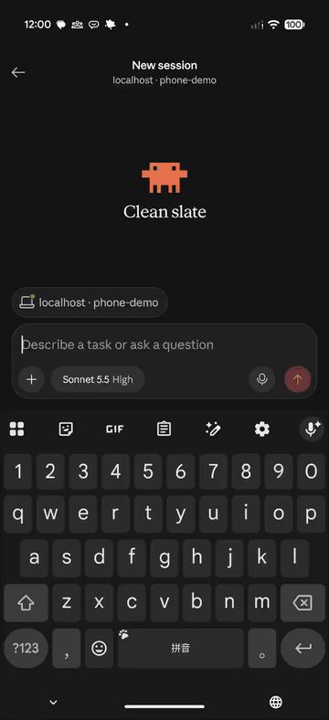

<div align="center">

# termux-agent-kit

**Run AI coding agents natively on your Android phone, and let them use the phone.**

Claude Code and Antigravity CLI, running in Termux. No root, no proot, no VM.

[](LICENSE)


[](#contributing)

English | [简体中文](README.zh-CN.md)

</div>

---

## Contents

- [Demo](#demo)
- [Why](#why)
- [Features](#features)
- [Requirements](#requirements)
- [Quick start](#quick-start)
- [Supported agents](#supported-agents)
- [Documentation](#documentation)
- [Before you hand over your phone](#before-you-hand-over-your-phone)
- [Troubleshooting](#troubleshooting)
- [Repository layout](#repository-layout)
- [Related projects](#related-projects)
- [Contributing](#contributing)
- [License and disclaimer](#license-and-disclaimer)

## Demo

<div align="center">



*Claude Code takes a prompt from the Claude app on the same phone, orders in DoorDash and stops at checkout. Shown at 6x speed; personal details are blurred.*

</div>

Full recordings in real time: [Claude Code, about 2 min](https://github.com/hongdp/termux-agent-kit/releases/download/demo-videos/claude-code-demo.mp4) · [Antigravity CLI, about 6 min](https://github.com/hongdp/termux-agent-kit/releases/download/demo-videos/antigravity-cli-demo.mp4)

## Why

I used to run my agents on a PC and a Linux workstation and connect to them from my phone. Then one day, while I was away, the workstation went offline because of a loose network cable, and I started to wonder: do I really need a beefy machine just to run agents? Why can't they run on the phone directly?

Termux has been able to do this kind of thing for years, but working in a CLI on a phone is painful. With an agent, that stops being a problem: the agent does the typing.

## Features

- **Agents on the phone.** Claude Code runs through the glibc wrapper in this repo. Antigravity CLI has a native Android build.
- **Prompts from the agent's own app.** Start the agent in Termux with remote control on, then talk to it from the Claude app or the Antigravity web page on the same phone.
- **Android development on the phone.** The agent edits the code, builds with Gradle, installs over a local adb connection and takes a screenshot to check its work.
- **Phone automation.** With the same adb connection the agent can open any app, read the screen, tap and type. It can get a food order ready and stop at checkout so you press the final button yourself. It can even do your Duolingo lesson on a busy day to save your streak. (Not recommended. The owl will be satisfied, but you won't learn a word.)

One prompt both agents handled from start to finish, sent from their client on the phone:

> Open DoorDash, order a milk tea from the nearest Tong Sui, you pick the drink, stop at the checkout page.

Each one found the store, picked a drink, set the options, reached the checkout page, stopped there and switched back to its client.

## Requirements

- An Android phone with a 64-bit ARM processor (`aarch64`)
- [Termux](https://github.com/termux/termux-app/releases) and [Termux:API](https://github.com/termux/termux-api/releases), both from the same source
- Wi-Fi, for Wireless debugging
- An account for the agent you use: a Claude subscription or a Google account

No root and no computer.

## Quick start

The short version. [docs/setup.md](docs/setup.md) has every step with a check after each one.

```sh
# 1. Packages (upgrade first, so all packages are on matching versions)
apt-get update && apt-get full-upgrade -y
pkg install -y git android-tools termux-api tmux nmap

# 2. An agent (Claude Code shown; for Antigravity CLI see docs/antigravity.md)
git clone https://github.com/hongdp/termux-agent-kit.git
cd termux-agent-kit && bash install.sh

# 3. adb to the phone itself: turn on Wireless debugging in Developer options.
#    Keep the pairing dialog open in split screen while you type the code;
#    the connect port is a different one, shown on the Wireless debugging page.
adb pair 127.0.0.1:<pairing-port> <code>
adb connect 127.0.0.1:<connect-port>

# 4. A folder with instructions for the agent
mkdir -p ~/projects/phone
cp phone/AGENTS.md phone/act.sh phone/adb-connect.sh ~/projects/phone/
ln -s AGENTS.md ~/projects/phone/CLAUDE.md

# 5. Go
cd ~/projects/phone && claude
```

Then ask for something small first:

> Open Settings and tell me which Android version this phone runs. Then switch back to Termux.

## Supported agents

| Agent | How it runs in Termux | Remote control from the phone | Guide |
| --- | --- | --- | --- |
| Claude Code | Official `linux-arm64` binary, patched to use Termux's glibc by `install.sh` | Claude app | [docs/claude-code.md](docs/claude-code.md) |
| Antigravity CLI (`agy`, Gemini) | Official native Android binary | Web page in a browser | [docs/antigravity.md](docs/antigravity.md) |

Other agents have not been tested here. If one runs in Termux, can run `adb` and can look at a PNG, the phone kit should work with it. Reports are welcome.

## Documentation

| Guide | What it covers |
| --- | --- |
| [Setup from scratch](docs/setup.md) | Every step from a stock phone to a working agent, with checks and a pitfalls table |
| [Phone automation](docs/phone-automation.md) | The look-decide-act loop, remote control, split screen on foldables, test results, lessons learned |
| [Android development](docs/android-dev.md) | Building, installing and debugging Android apps on the phone |
| [Claude Code in Termux](docs/claude-code.md) | How the wrapper works, updating, rolling back, known issues, uninstalling |
| [Antigravity CLI in Termux](docs/antigravity.md) | Install, permissions on Android, memory, remote control |

## Before you hand over your phone

The agent acts with your accounts, on your phone.

- The instruction template tells it to stop before anything that spends money or sends something to another person. Keep that rule.
- Watch it work, at least until you trust a task. On a foldable or tablet, split screen keeps the terminal visible next to the app.
- Many apps forbid automated use in their terms of service. Use this for your own experiments, testing and accessibility needs.
- Tested on one device, a Pixel 10 Pro Fold on Android 17. Other phones may need small changes, such as display ids.

## Troubleshooting

The ones people hit first. The full table is in [docs/setup.md](docs/setup.md#pitfalls).

| What you see | What to do |
| --- | --- |
| Typed text is wrong or missing | Paste instead of `input text`: `termux-clipboard-set "text"; adb shell input keyevent 279` |
| `claude remote-control`: "Workspace not trusted" | Start it in a project folder, not the home directory, after running `claude` there once |
| `grep` / `find` fail inside Claude Code with `invalid ELF header` | Use `command grep` and `command find` |
| `adb devices` is empty after a reboot | The port changed: run `./adb-connect.sh` in the agent's folder |

## Repository layout

```
install.sh              Installs Claude Code for Termux (glibc, patched binary, wrapper)
claude                  Wrapper script, installed to $PREFIX/bin/claude
claude-termux-update    Update, list versions, roll back
shim-bash               Shell shim for Claude Code's Bash tool
phone/AGENTS.md         Instruction template for any agent (also in zh-CN)
phone/act.sh            Run taps, swipes and pastes, return when the screen settles
phone/adb-connect.sh    Find the Wireless debugging port again and reconnect adb
docs/                   Guides, each in English and Simplified Chinese
docs/media/             Demo GIF used in this README
```

## Related projects

Other people are working on the same idea from different angles. If this repo doesn't fit your setup, one of these may:

- [termux-coding-agents](https://github.com/bobbymac/termux-coding-agents) runs Claude Code and other agents in Termux with a different technique that also covers the Google Play build of Termux and keeps Claude Code's own updater. `phone/adb-connect.sh` here follows the port-discovery approach of its `adb-local`.
- [android-agent](https://github.com/nebigoktug/android-agent) is a CLI and MCP server for letting an agent use Android apps, from a PC or from Termux on the phone.
- [droidrun](https://github.com/droidrun/droidrun) and [mobile-use](https://github.com/minitap-ai/mobile-use) are standalone frameworks for agents that control phones.

We have read the first one and not used the others; the descriptions come from their own READMEs.

## Contributing

Issues and pull requests are welcome. The most useful contributions right now:

- **Device reports.** What worked or didn't on your phone and Android version.
- **Other agents.** Steps to run another coding agent in Termux, with what you tested.
- **Pitfalls.** A problem you hit and how you got past it, for the table in [docs/setup.md](docs/setup.md#pitfalls).

Please describe only what you actually ran, and keep both language versions of a doc in step when you change one.

## License and disclaimer

[MIT](LICENSE).

This repository contains install scripts, helper scripts and documentation. It does not include or redistribute Claude Code or Antigravity CLI: your device downloads them from their official sources, and their use is subject to Anthropic's and Google's terms. This project is not affiliated with Anthropic, Google, or any app mentioned in the docs.
