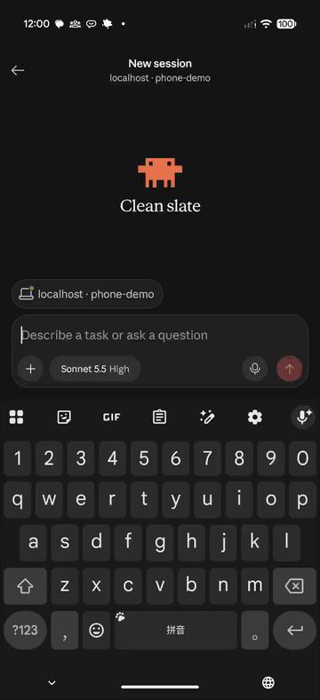

<div align="center">

# claude-termux

**在安卓手机上原生运行 AI 编程 agent，并让它们操作这台手机。**

Claude Code 和 Antigravity CLI，跑在 Termux 里。不用 root，不用 proot，不用虚拟机。

[](LICENSE)


[](#参与贡献)

[English](README.md) | 简体中文

</div>

---

## 目录

- [演示](#演示)
- [起因](#起因)
- [功能](#功能)
- [环境要求](#环境要求)
- [快速上手](#快速上手)
- [支持的 agent](#支持的-agent)
- [文档](#文档)
- [把手机交给 agent 之前](#把手机交给-agent-之前)
- [常见问题](#常见问题)
- [仓库结构](#仓库结构)
- [参与贡献](#参与贡献)
- [许可证与声明](#许可证与声明)

## 演示

<div align="center">



*Claude Code 从同一台手机上的 Claude App 收到提示词，在 DoorDash 里点单，并停在结账页。画面为 6 倍速，个人信息已打码。*

</div>

原速完整录像：[Claude Code，约 2 分钟](https://github.com/hongdp/claude-termux/releases/download/demo-videos/claude-code-demo.mp4) · [Antigravity CLI，约 6 分钟](https://github.com/hongdp/claude-termux/releases/download/demo-videos/antigravity-cli-demo.mp4)

## 起因

我以前把 agent 跑在 PC 和一台 Linux 工作站上，再从手机远程连过去。有一天我不在家，工作站因为网线松了突然掉线，我开始想：跑 agent 真的需要这么强的机器吗？为什么不能直接跑在手机上？

Termux 很多年前就能做这类事，但在手机上敲命令行实在太难受。有了 agent，这就不是问题了：打字的是 agent。

## 功能

- **agent 跑在手机上。** Claude Code 通过本仓库的 glibc 包装运行；Antigravity CLI 有原生 Android 版本。
- **用 agent 自己的 App 发指令。** 在 Termux 里启动 agent 并打开遥控，然后在同一台手机上用 Claude App 或 Antigravity 网页和它对话。
- **在手机上开发 Android 应用。** agent 改代码、用 Gradle 编译、通过本机 adb 安装，再截图检查结果。
- **手机自动化。** 用同一个 adb 连接，agent 可以打开任何 App、看屏幕、点击、打字。它可以把外卖订单准备好，停在结账页，最后一步由你自己点。忙的时候，它甚至能替你把当天的 Duolingo 做完，连续天数就不会断。（不建议这么做：猫头鹰是满意了，可你一个词也没学到。）

下面这句提示词，两个 agent 都从头到尾完成了，提示词是从手机上它们各自的客户端发出的：

> 打开 DoorDash，帮我在最近的糖水（Tong Sui）点一杯奶茶，种类你来选，停在结账页面。

它们各自找到店、选好饮品、设好选项、到达结账页后停下，然后切回自己的客户端。

## 环境要求

- 64 位 ARM 处理器（`aarch64`）的安卓手机
- [Termux](https://github.com/termux/termux-app/releases) 和 [Termux:API](https://github.com/termux/termux-api/releases)，两者要来自同一个来源
- Wi-Fi，无线调试需要
- 你要用的 agent 的账号：Claude 订阅或 Google 账号

不需要 root，也不需要电脑。

## 快速上手

下面是精简版。[docs/setup.zh-CN.md](docs/setup.zh-CN.md) 里有完整步骤，每一步后面都有检查。

```sh
# 1. 安装依赖（先整体升级，让所有包的版本互相匹配）
apt-get update && apt-get full-upgrade -y
pkg install -y git android-tools termux-api tmux

# 2. 安装一个 agent（这里是 Claude Code；Antigravity CLI 见 docs/antigravity.zh-CN.md）
git clone https://github.com/hongdp/claude-termux.git
cd claude-termux && bash install.sh

# 3. 把 adb 连到手机自己：在开发者选项里打开无线调试。
#    输入配对码时用分屏让配对弹窗一直开着；
#    连接端口是另一个，显示在无线调试页面上。
adb pair 127.0.0.1:<配对端口> <配对码>
adb connect 127.0.0.1:<连接端口>

# 4. 给 agent 准备一个带说明文件的目录
mkdir -p ~/projects/phone
cp phone/AGENTS.zh-CN.md ~/projects/phone/AGENTS.md
cp phone/act.sh ~/projects/phone/
ln -s AGENTS.md ~/projects/phone/CLAUDE.md

# 5. 开始
cd ~/projects/phone && claude
```

先让它做一件小事试试：

> 打开设置，告诉我这台手机的 Android 版本，然后切回 Termux。

## 支持的 agent

| Agent | 在 Termux 里怎么运行 | 在手机上遥控 | 指南 |
| --- | --- | --- | --- |
| Claude Code | 官方 `linux-arm64` 二进制，由 `install.sh` 改成使用 Termux 的 glibc | Claude App | [docs/claude-code.zh-CN.md](docs/claude-code.zh-CN.md) |
| Antigravity CLI（`agy`，Gemini） | 官方原生 Android 二进制 | 浏览器里的网页 | [docs/antigravity.zh-CN.md](docs/antigravity.zh-CN.md) |

其他 agent 没有在这里测试过。只要它能在 Termux 里运行、能执行 `adb`、能看 PNG 图片，这套操作手机的工具应该就能用。欢迎反馈测试结果。

## 文档

| 指南 | 内容 |
| --- | --- |
| [从零开始配置](docs/setup.zh-CN.md) | 从一台普通手机到 agent 能用的每一步，带检查和踩坑对照表 |
| [手机自动化](docs/phone-automation.zh-CN.md) | “看、想、做”的循环、遥控、折叠屏分屏、实测结果、踩坑经验 |
| [Android 开发](docs/android-dev.zh-CN.md) | 在手机上编译、安装、调试 Android 应用 |
| [Termux 里的 Claude Code](docs/claude-code.zh-CN.md) | 包装的原理、更新、回滚、已知问题、卸载 |
| [Termux 里的 Antigravity CLI](docs/antigravity.zh-CN.md) | 安装、Android 上的权限、记忆、遥控 |

## 把手机交给 agent 之前

agent 用的是你的账号，操作的是你的手机。

- 说明模板要求它在花钱或给别人发东西之前停下。请保留这条规则。
- 刚开始最好全程看着它操作，等你对某类任务放心了再放手。折叠屏和平板可以用分屏，让终端一直显示在 App 旁边。
- 很多 App 的用户协议不允许自动化使用。这套方法适合自己做实验、做测试，或者用于无障碍需求。
- 只在一台设备上测试过：Pixel 10 Pro Fold，Android 17。其他手机可能要做些小改动，比如屏幕 ID。

## 常见问题

下面是最容易先碰到的几个问题。完整的对照表在 [docs/setup.zh-CN.md](docs/setup.zh-CN.md#踩坑对照表)。

| 现象 | 怎么办 |
| --- | --- |
| 输入的文字不对或者没输进去 | 不用 `input text`，改用粘贴：`termux-clipboard-set "文字"; adb shell input keyevent 279` |
| `claude remote-control` 提示 “Workspace not trusted” | 在项目目录里启动，不要在主目录；并先在该目录运行一次 `claude` |
| Claude Code 里 `grep` / `find` 报 `invalid ELF header` | 用 `command grep` 和 `command find` |
| 重启后 `adb devices` 是空的 | 端口变了：`adb connect 127.0.0.1:<新端口>` |

## 仓库结构

```
install.sh              安装 Termux 版 Claude Code（glibc、打过补丁的二进制、包装脚本）
claude                  包装脚本，安装到 $PREFIX/bin/claude
claude-termux-update    更新、列出版本、回滚
shim-bash               给 Claude Code 的 Bash 工具用的 shell 转接脚本
phone/AGENTS.md         给任何 agent 用的说明模板（另有中文版）
phone/act.sh            执行点击、滑动、粘贴，屏幕稳定后返回
docs/                   各篇指南，均有英文和简体中文版
docs/media/             本页用到的演示 GIF
```

## 参与贡献

欢迎提 issue 和 pull request。目前最有用的贡献是：

- **设备反馈。** 你的手机型号和 Android 版本，以及哪些能用、哪些不能用。
- **其他 agent。** 在 Termux 里运行另一个编程 agent 的步骤，以及你测试过什么。
- **踩坑记录。** 你遇到的问题和解决办法，可以加进 [docs/setup.zh-CN.md](docs/setup.zh-CN.md#踩坑对照表) 的对照表。

请只写你实际跑过的内容；改动某篇文档时，请让两种语言的版本保持一致。

## 许可证与声明

[MIT](LICENSE)。

本仓库只包含安装脚本、辅助脚本和文档，不包含也不分发 Claude Code 或 Antigravity CLI：它们由你的设备从各自的官方来源下载，使用时需遵守 Anthropic 和 Google 的条款。本项目与 Anthropic、Google 以及文档中提到的任何 App 均无关联。
